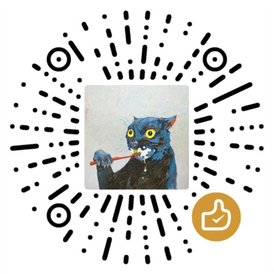

# TagMyBookmarks

给书签打标签，查的时候用标签组合条件，不需要回忆它当初被塞进了哪个文件夹。

作者 vivikuyo。仓库 <https://github.com/vivikuyo/tagmybookmarks>。当前版本 1.0.1。

## 一、它解决什么

Chrome 的书签只能放一个文件夹。同一条书签想同时归到目录 A 和目录 B，只能挑一个。文件夹套得越深，找东西越靠记性。想按「有标签 A、没有标签 B」这种条件筛，靠文件夹翻不出来。同一个网址收藏过几次，几处的标签互相不通气。标签写法不统一，也只能一条条手改。

这里的做法是把标签写进书签标题，查的时候按标签组合。文件夹还留着，你照旧用。

## 二、标签是什么样

```
Chrome 扩展开发入门 [#书签文件夹A][#Chrome]
Chrome 扩展开发入门 [#书签文件夹A][#Chrome] [**p:1]
```

标签写在标题末尾，一对方括号装一个标签，前面保留原标题。标签名可以有空格、中文、加号、井号，比如 `C++` 或者「#设计 规范」都行；不能含 `[ ] ; = ,` 这五个字符，它们是配置串的分隔符。`JS` 和 `js` 算同一个标签。标签在标题里按码点排序，两台设备同步时序列化才不会来回变。

标签就存在标题里。所以它跟着浏览器自带的同步走，不用服务器，也不用另存一份数据。

## 三、怎么查

| 写法 | 意思 |
|---|---|
| `a, b` 或 `a & b` | 同时满足 |
| `a + b` 或 `a \| b` | 满足任意一个 |
| `a - b` | 满足 a 但不满足 b |
| `!a` 或 `~a` | 全部里排除 a |
| `?关键词` | 搜标题和网址里的字 |
| `(a + b), c` | 分组 |
| `a b` | 挨着写等于同时满足 |
| `C\+ \+` | 标签名里有 `+ - & , \| ! ~ ? ( )` 时用 `\` 转义 |

逗号、`&`、加号、减号同级，从左往右算；感叹号和问号结合得更紧。运算符写错了会就地丢掉并给个提示，不会整条查询作废。

同一个名字先不分是标签还是文件夹。裸名 A 等于打了标签 A 的书签，加上目录 A 里的书签（子级也算），两边合在一起。`@A` 只看文件夹，`#A` 只看标签。可以混着写：`@A & #B`。

输入框空着时显示全部打过标签的书签。想看连没打标签的一起，点标签云里那个虚线的「全部书签」。

## 四、三个界面

侧边栏是平时查东西的地方。上面是查询框，下面是两朵云：相关标签和目录。含书签的文件夹会在这里出现，点一下等于往查询里加 `@目录名`。列表有两种视图。清单只列命中的书签。目录视图把整棵书签树铺开，查询只负责标出命中的那些，不删行——命中的书签上色，查询不为空时只展开命中目录和它的上级，别的收起，清空查询就回到你手动调出来的样子。两种视图都能拖放移动书签。目录视图里文件夹组头前面有个勾选框，勾上等于把这一枝全选中：目录自己、各级子目录、里面所有书签都进选中集，空文件夹也能勾。加标签、摘标签、清空、打开只作用于书签，目录不算数；只勾了空目录时点这些按钮会提示没有可操作的书签。按删除会把整个目录连同里面的书签移进回收站，能撤销——父子目录只发最上层那个，不会重复搬。勾选变化时会弹一条提示报数：已勾选 N 条书签 + M 个目录。顶栏右上角一直显示条数，这个数字是物理书签条数——同一网址收藏了两次就算两条（列表本身仍按网址去重成一行，所以数字可能比列表行数大）。行密度是顶栏一个图标按钮：三根线是标准、四根是紧凑、五根是极简，点一下切下一档，悬停提示写着当前档位和下一档。密度改的是列表行和目录结构（行高、组头、三角），云里的标签和目录 chip 不跟着缩，大小只跟面板高度走；行变矮多出来的高度会分给内容放不下的那一栏，标签少的那栏按内容贴紧。清单与目录是列表自己的事，留在列表上方的操作带里，做成两段小开关，折叠紧挨着它，是个双向箭头图标，只在目录视图出现。批量动作（加、摘、清空、打开、删除）改成图标按钮，悬停有说明；摘、清空、删除仍要点两次——第一次会变成红底「确认」。这样一行装得下：全选、取消选择、视图开关、折叠、输入框、五个动作。取消选择紧挨全选框，属于"选择"这一组。

管理台用来整理，分三页。概览给四个数字：书签数、唯一网址数、标签数、没打标签的数，再附一份健康检查，15 类问题里 6 类能一键修，其余只报告，因为修它们得猜你想删哪个标签，猜错就丢数据。标签页是标签墙，可以按「没设颜色」「只出现一次」来筛，选中几条批量重命名、合并到某个标签、或者删掉标签（只摘标签，书签本身不动），执行前先说清会改多少条、大概几秒。书签页有文件夹树、双栏视图、复制剪切粘贴、回收站和撤销。

工具栏弹窗用来给当前页打标签。输入框下面实时提示会加几个标签，收藏位置记住上次选的，推荐标签只补进输入框，不会自己提交。

## 五、数据放在哪

书签内容在标题里，配置在三条配置文件书签里：

```
其他书签 / TagSpace /
    TagSpace 配置·颜色     →  space.html#cfg=colors
    TagSpace 配置·偏好     →  space.html#cfg=prefs
    TagSpace 配置·别名     →  space.html#cfg=aliases
```

认的是 URL 里的 `#cfg=`，不是标题，所以在原生管理器里改标题不会弄坏识别。三个文件互不影响，颜色坏了偏好照常。删掉任意一个，下次启动会自动重建，并尽量从本机快照恢复。两台设备在首次同步完成前各建了一套的话，配置页顶部会出黄色横幅，点一下就合并，内容取并集、冲突留较早那份。只有你手动改过颜色的标签才写进颜色文件，其余按标签名哈希从 12 色里取。

## 六、做不到的事和代价

标题会带 `[#标签]`，地址栏补全、原生管理器、手机上都看得见。这是跟着 Chrome 同步换来的。

手动改标题里的标签组，等于改标签，扩展会按新的事实重建索引。

重命名或删除标签要重写标题，几百条要等几秒。

同一个网址收藏在多处时标签共享，给其中一处打标签，别的位置一起变。

撤销管得住标签改写和移动、删除、还原；回收站里的「彻底删除」和「清空回收站」是真删，撤不回来。撤销记录存在本机，最多 20 条。

目录名里带空格的暂时写不进 `@` 查询，因为词法在 `@` 后面不认引号。chip 还是能点。

回收站按路径记位置，不按 id，因为书签 id 不跨设备。目录改名或者移动过，要重新设一次。

不做的事：自动推断标签、自建同步服务、往原生右键菜单里塞东西。

## 七、安装

去 [Releases](https://github.com/vivikuyo/tagmybookmarks/releases) 下 `TagMyBookmarks-1.0.1.zip`，解压，得到一个含 `manifest.json` 的文件夹。

1. 打开 `chrome://extensions`
2. 右上角打开「开发者模式」
3. 点「加载已解压的扩展程序」，选那个文件夹
4. 点扩展图标旁边的图钉，固定到工具栏

也可以用 `git clone` 把仓库拉下来，直接加载 `tagspace/` 目录。

首次加载会自己建几样东西：`其他书签` 下的 `TagSpace/` 文件夹（放三条配置文件书签）、`TagSpace 收件箱`（给还没收藏的页面打标签用）、以及索引（5000 条约 50 毫秒）。

支持 Chrome、Edge、Vivaldi 等 Chromium 内核的浏览器。Vivaldi 没有实现 `chrome.sidePanel`，侧边栏会退化成独立小窗。

## 八、名字的来由

扩展的显示名、页面标题、日志前缀都叫 TagMyBookmarks。磁盘上的标识故意没跟着改：配置文件夹还是 `其他书签/TagSpace/`，收件箱还是 `TagSpace 收件箱`，配置文件的标题也还是旧的。

这些名字已经是真实书签躺在你的 Chrome 里了，还跟着同步走。改名等于让扩展找不到旧配置，再另建一套。要统一得做一次数据迁移，那是单独一件事。

## 九、快捷键

`Cmd/Ctrl+Shift+Y` 开侧边栏，`Cmd/Ctrl+Shift+E` 开管理台。地址栏输入 `tb` 加标签名，回车打开带这个查询的页面。`Ctrl+Shift+O` 被 Chrome 书签管理器占了，所以没选它。

## 十、代码与测试

```
tagspace/
├── manifest.json    MV3，没有构建步骤
├── background.js    Service Worker：配置自愈、索引、写通道、查询、消息路由
├── lib/             标题解析、索引、查询、配置、批量计划、健康检查、调色板，都是纯函数
├── sidepanel/       侧边栏
├── space/           管理台：概览、标签、书签、配置编辑
├── popup/           工具栏弹窗
├── icons/
└── tests/
```

```
node tests/run.mjs        纯逻辑单测 937 项
node tests/dom-smoke.mjs  手写 DOM 桩真跑侧栏 panel.js，29 项（能抓运行时崩溃）
node tests/e2e-mock.mjs   假 chrome API 跑真 background.js，218 项
```

## 求打赏

此扩展纯本地化运行，无需联网。标签完全兼容使用浏览器自带的同步。

写这个扩展不算难，难的是后续维护，挺费心思的，但是也乐在其中。

如果你觉得它替你省下过一点时间，愿意请我喝一罐可乐，我会记着哥们的人情。不愿意也完全没关系，谢谢每一个把它留在扩展栏里的人。

<table>
  <tr>
    <td align="center"><br><sub>微信</sub></td>
    <td align="center"><br><sub>支付宝</sub></td>
  </tr>
</table>

两张图都是本地静态图片，扩展不会因为它们发起任何请求；打赏没有回执，也没有任何记录，不打赏不影响任何功能。
